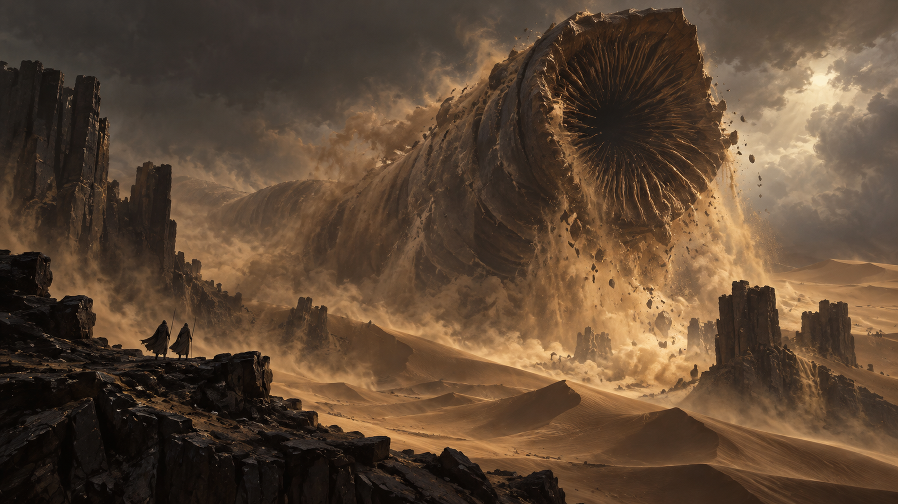

<p align="center">
  
</p>

# Omarchy Dune Theme

An Omarchy theme for dark terminals on Arrakis. The room is almost black. Parchment is the ink. Imperial gold is the accent. Rust, sage, dusk blue, magenta, and stillwater sit in the ANSI slots.

## Install

```sh
omarchy-theme-install https://github.com/csfh/omarchy-dune-theme
```

You can also install it from the Omarchy menu with `Super + Alt + Space`, then `Install > Style > Theme`, using this repository URL:

```text
https://github.com/csfh/omarchy-dune-theme
```

## Palette

| Role | Hex |
| --- | --- |
| Background | `#0D0C0B` |
| Foreground | `#E8E0D4` |
| Accent | `#D6A63C` |
| Red | `#C45C3A` |
| Green | `#6B9A4A` |
| Yellow | `#D6A63C` |
| Blue | `#4A86C4` |
| Magenta | `#D6457A` |
| Cyan | `#3DB8B0` |

## Included

Desktop, terminal, editor, launcher, notification, bar, lock screen, browser, Discord, and TUI theme files for Omarchy:

`alacritty`, `btop`, `chromium`, `foot`, `ghostty`, `gtk`, `hyprland`, `hyprlock`, `kitty`, `mako`, `neovim`, `swayosd`, `vencord`, `vscode`, `walker`, `warp`, `waybar`, `wofi`, and `zellij`.

## Backgrounds

The wallpapers are original illustrations, Lanczos-scaled to 4K:

- [`arrakeen-court`](backgrounds/arrakeen-court.webp) — the throne hall in the desert keep
- [`giedi-prime`](backgrounds/giedi-prime.webp) — the industrial court
- [`caladan`](backgrounds/caladan.webp) — the cliff keep in the rain
- [`shai-hulud`](backgrounds/shai-hulud.webp) — the worm in the dunes
- [`guild-navigator`](backgrounds/guild-navigator.webp) — the tank in the spice hall

## License

MIT. See [LICENSE](LICENSE). Copyright (c) 2026 Christoffer Hallas.

If you send a pull request or other contribution, you agree to the [CLA](CLA.md).
